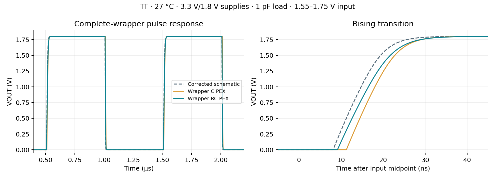

# Complete-wrapper verification

Local physical verification and nominal functional checks pass for the current
`tt_um_armohamed_r2rvc` GDS. Review the GitHub Actions results for the exact
revision selected for submission. Allocation, revision submission, and order status are managed in the Tiny
Tapeout app.

## Additional operating-range characterization (21 November 2026)

Separate RC-PEX PVT and native local-mismatch scans use the unchanged physical
design at source commit `007af305f79430bfe27b4513410a53def5a6e022`.
All tested common-mode grid points from 0.3 to 2.4 V pass the declared
settling criterion across 335 principal runs. Higher common modes have
failures. The project is submitted as a comparator prototype with these
documented limits, not an unrestricted 0-3.3 V performance guarantee.

See [operating_range_validation.md](verification/operating_range_validation.md)
for the conditions, exact counts, and model limitations. The nominal results
and reproduction script below retain their original scope.

## Physical checks

| Check | Result |
|---|---|
| Unmodified Tiny Tapeout precheck | **15 / 15 PASS** |
| Raw Magic full DRC of complete wrapper | **0 error boxes** |
| Hierarchical transistor-level LVS | **Match** |
| Flattened transistor-level LVS | **Match** |
| RC topology LVS (route R shorted, C removed) | **Match** |
| Independent wrapper geometry connectivity | **All checks pass** |

The provider checks include Magic full DRC, KLayout FEOL/BEOL/offgrid,
pin-label overlap, zero area, boundary and pin locations, power interface,
valid layers, cell names, nwell/urpm, analog-pin allocation, and Verilog syntax.
The exact reports are in `verification/precheck_reports/`.

The unmodified precheck code matches `TinyTapeout/tt-support-tools` main commit
`8f7b5060d7f6df73bfd2e0b8d8fa0fd1dca0a0b1`. The PDK revision is the same
SKY130A revision selected by the hosted action:
`0536d02d875c8f67dd7cca3902ac457e62f20005`.
Local executable versions are recorded in `verification/tool_versions.json`.
They are not a claim that every hosted executable version is identical.

## Changes since the comparator-only package

The routed 145.360 × 225.760 µm wrapper follows the official 1x2, 3.3 V DEF.
It connects VINP/VINM to ua[0]/ua[1], VOUT to uo_out[0], VDD to VAPWR,
DVDD to VDPWR, and both grounds to VGND. All unused digital output and
output-enable pins are physically tied to ground. The DEF signal pins retain
their prescribed sizes and locations, and the power stripes meet precheck.

The original mixed-voltage level-shifter cell received 0.4 µm additional
horizontal separation at local x = 3.53 µm. Its instance moved down by 0.4 µm
to retain deep-nwell clearance. The comparator's input landing follows that
move, and its met2 enclosure was restored. The modified cell has the distinct
name `arm_r2rvc_lsbufhv2lv`. All MOS W/L values are retained and matched by LVS.
This physical change allows the raw GDS to pass full DRC without the previous
HVI-mask restoration script, a relaxed rule deck, or a waiver.

The bias resistor retains its VDD-biased well, and the schematic third terminal
is explicitly VDD. Its fixed-width model is `sky130_fd_pr__res_high_po_1p41`.
The drawn effective length is within the PDK's standard 1% comparison tolerance
of the schematic's 141 µm value. No matching tolerance was expanded.

## Nominal post-layout simulation

Conditions: SKY130A TT, 27 °C, VAPWR = 3.3 V, VDPWR = 1.8 V, output load =
1 pF. VINM = 1.65 V. VINP switches between 1.55 and 1.75 V at 1 MHz with
1 ns edges. Propagation delays use input 1.65 V and output 0.9 V crossings.
Power and currents are averaged over 0.2–2.8 µs. These input conditions differ
from the earlier comparator-only rail-to-rail pulse test, so their delay
numbers should not be compared directly.

| Measurement | Corrected schematic | Wrapper RC PEX |
|---|---:|---:|
| Rise propagation delay | 14.0388 ns | 15.6923 ns |
| Fall propagation delay | 10.4550 ns | 11.7562 ns |
| Average analog current | 314.5892 µA | 297.6546 µA |
| Average digital current | 2.1583 µA | 2.1960 µA |
| Average total supply power | 1.0420 mW | 0.9862 mW |

The RC output is 0.200 mV at the low-level sample
and 1.799999 V at the high-level sample.
Corrected schematic, C PEX, and distributed RC PEX all pass the logic test.
The complete numeric summary is `verification/simulation_summary.json`.
The script `tools/run_simulations.py` generates and runs all three testbenches.

The RC netlist contains 11,046 route-resistor elements, 5,890
parasitic-capacitor elements, and 107 model instances before LVS reduction.
Magic `extresist tolerance 10` selected 56 of 98 candidate nets; external
ports were forced as drive points. Capacitor and resistor output thresholds
were zero, and resistor tee modelling was enabled. Small nets below the
resistance-extraction tolerance are not claimed as fully distributed.
Unused digital inputs are held low (ena high); unused analog pins have a
1 TΩ reference resistor for DC numerical stability. The analog switch, full
chip PDN, board, package, and measurement path are outside this wrapper PEX.

## Scope and next action

The nominal simulations in this file and the additional range study have
separate documented scopes. Neither establishes complete-chip density,
antenna, or packaged-silicon qualification. Check the hosted precheck on the
submission commit. Then select this repository in the Tiny Tapeout app with
1x2 area, two analog pins, and VAPWR enabled. Review the allocated shuttle,
capacity, price, and hardware options before placing the order.
